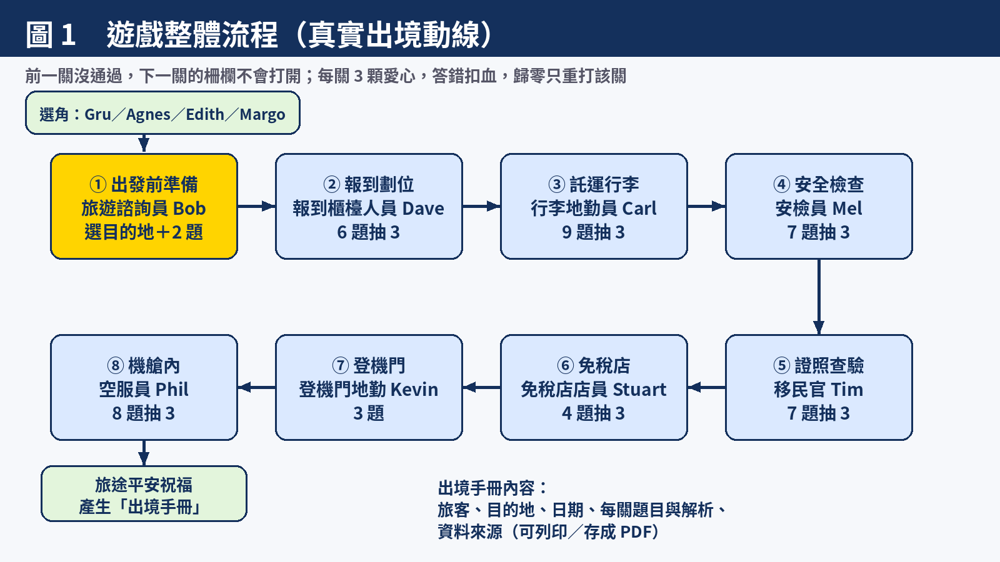
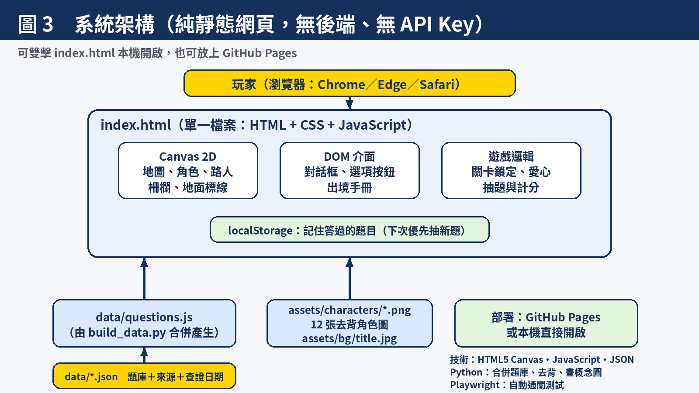
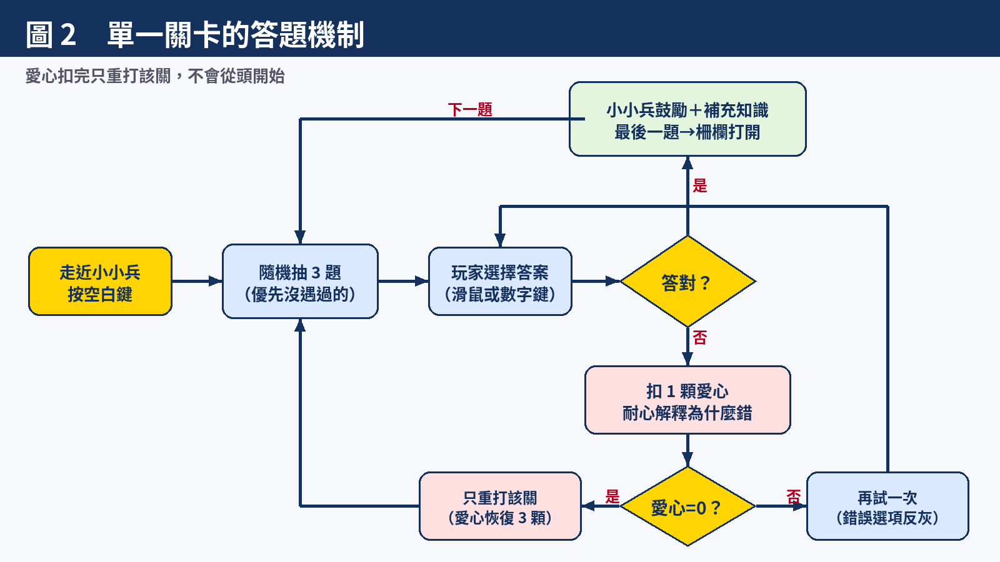
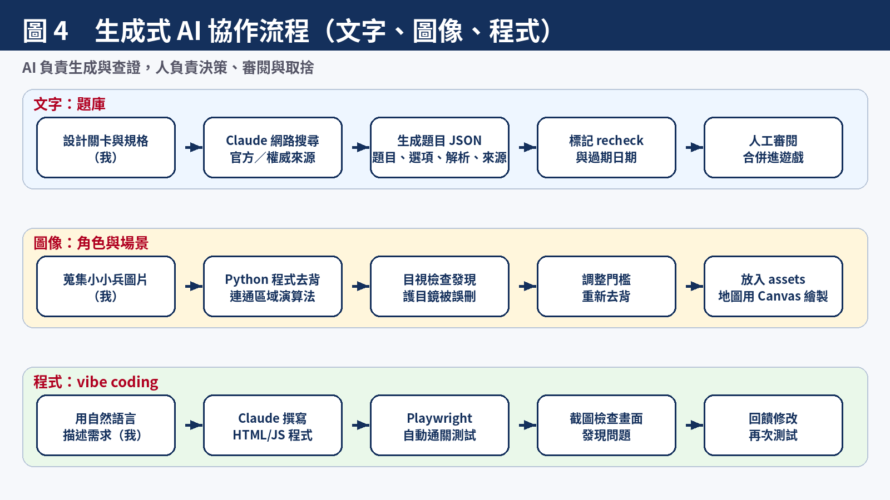

# 小小兵機場出境大冒險 ✈️

> 生成式 AI：文字與圖像生成的原理與實務　期末專案
> 一款像寶可夢的 2D 俯視角網頁遊戲：跟著小小兵走完桃園機場的出境流程，邊玩邊學出國該知道的規定，最後自動整理成「出境手冊」。



## 一、專案簡介

| 項目 | 說明 |
|---|---|
| 類型 | 網頁 RPG 闖關遊戲（純靜態網頁，無後端） |
| 場景 | 桃園機場（通用版），共 8 關，依真實出境動線排列 |
| 角色 | 玩家可選 Gru／Agnes／Edith／Margo；各關由不同小小兵擔任機場工作人員 |
| 題庫 | 機場關卡 44 題＋10 個目的地 40 題，共 **84 題**，每題附資料來源與查證日期 |
| 特色 | 每次遊玩隨機抽題（優先抽沒遇過的）、答錯扣血並耐心解釋、結束後產生個人化出境手冊 |

## 二、怎麼玩

1. 下載專案後，**直接雙擊 `index.html`** 即可（不需要安裝或伺服器）；也可部署到 GitHub Pages。
2. 選角後，用 **方向鍵／WASD** 移動，靠近小小兵按 **空白鍵** 對話；選項可用滑鼠點或按數字鍵。
3. 第 1 關先選目的地，再依序通過 8 個關卡。**前一關沒過，前方柵欄不會打開。**
4. 每關 3 顆愛心，答錯扣 1 顆並解釋原因；愛心用完只重打該關。
5. 全部通關後，查看並列印／存成 PDF 的「出境手冊」。

## 三、關卡與角色

| 關卡 | 角色 | 重點知識 |
|---|---|---|
| ① 出發前準備 | 旅遊諮詢員 Bob | 選目的地，答該國入境小問題（日、韓、泰、越、新、美、英、澳、中國大陸、港澳） |
| ② 報到劃位 | 報到櫃檯人員 Dave | 提早到機場、行李保護套、機捷預辦登機、自助託運 |
| ③ 託運行李 | 行李地勤員 Carl | 行動電源、風扇、刀剪、打火機、貴重物品 |
| ④ 安全檢查 | 安檢員 Mel | 液體 100ml、行動電源 100Wh、禁帶物品、安檢等候時間 |
| ⑤ 證照查驗 | 移民官 Tim | 護照與登機證、e-Gate、現金與黃金申報 |
| ⑥ 免稅店 | 免稅店店員 Stuart | 管制區購物、回國肉製品規定、免稅額度 |
| ⑦ 登機門 | 登機門地勤 Kevin | 登機門分區、查詢方式、鋰電池檢查 |
| ⑧ 機艙內 | 空服員 Phil | 機上行動電源規定、起降準備、行李擺放、安全帶 |

## 四、系統架構



- **前端**：單一 `index.html`，用 HTML5 Canvas 繪製地圖與角色，用 DOM 做對話框與出境手冊。
- **資料**：題庫存成 `data/*.json`，`build_data.py` 合併成 `data/questions.js`（讓檔案可直接雙擊開啟，不受瀏覽器 `file://` 限制）。
- **素材**：`assets/characters/` 12 張去背角色圖、`assets/bg/title.jpg` 標題背景。
- **為什麼不即時呼叫 AI**：GitHub Pages 只能放靜態網頁，API Key 會暴露；預先生成並查證題庫，也能避免遊玩時出現幻覺錯誤。

## 五、答題機制



## 六、生成式 AI 的使用方式



1. **文字生成**：由 Claude 搜尋官方與權威來源後生成題目、選項、解析與小小兵口吻的回應，並附來源網址與查證日期；來源單一或可能過期的題目標記 `recheck`。
2. **程式生成（vibe coding）**：整個遊戲由 Claude 依自然語言需求撰寫，並用 Playwright 自動通關測試、截圖檢查。
3. **圖像處理**：角色圖由我蒐集，Claude 用程式去背；地圖場景由 Canvas 程式繪製。（詳見報告大綱的限制說明）

## 七、專案結構

```
├── index.html            遊戲本體
├── build_data.py         合併題庫 → data/questions.js
├── data/                 題庫（*.json）與合併檔（questions.js）
├── assets/               角色圖與背景
└── docs/                 報告大綱、資料來源、概念圖與產生程式
```

## 八、修改題庫

1. 編輯 `data/*.json`（每題包含：題目、選項、答案、答對與答錯的回應、來源）。
2. 執行 `python3 build_data.py` 重新產生 `data/questions.js`。

## 九、注意事項

- 題庫查證日期 **2026-11-07**，規定可能隨時更新；韓國 K-ETA 豁免期限為 2026-12-31，另有 7 題標記待再確認，詳見 [`docs/SOURCES.md`](docs/SOURCES.md)。
- 角色圖片版權屬 Illumination／Universal，僅供課堂作業、非商業用途。
- 目前尚未支援手機觸控操作，也還沒有音效與動畫。

更多內容請見 [`docs/REPORT_OUTLINE.md`](docs/REPORT_OUTLINE.md)。
